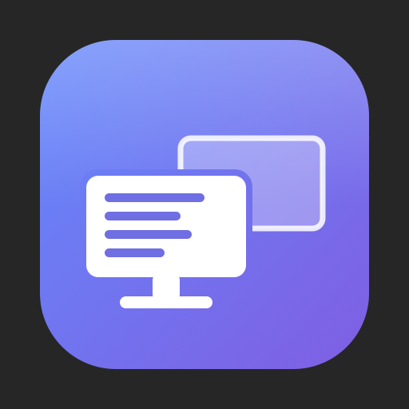
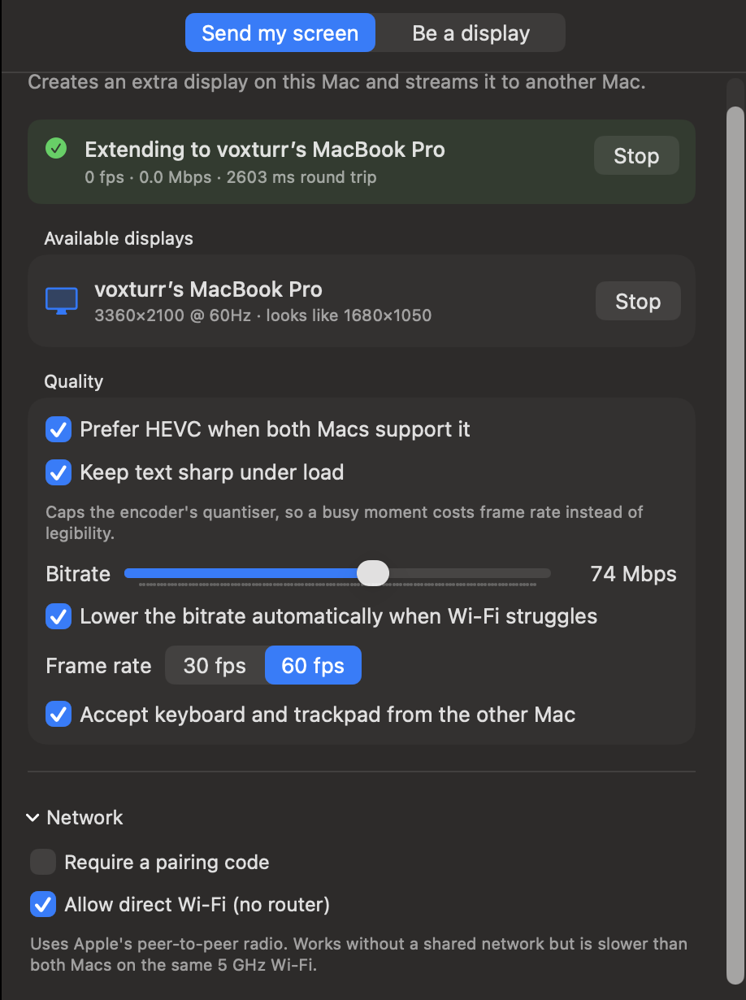
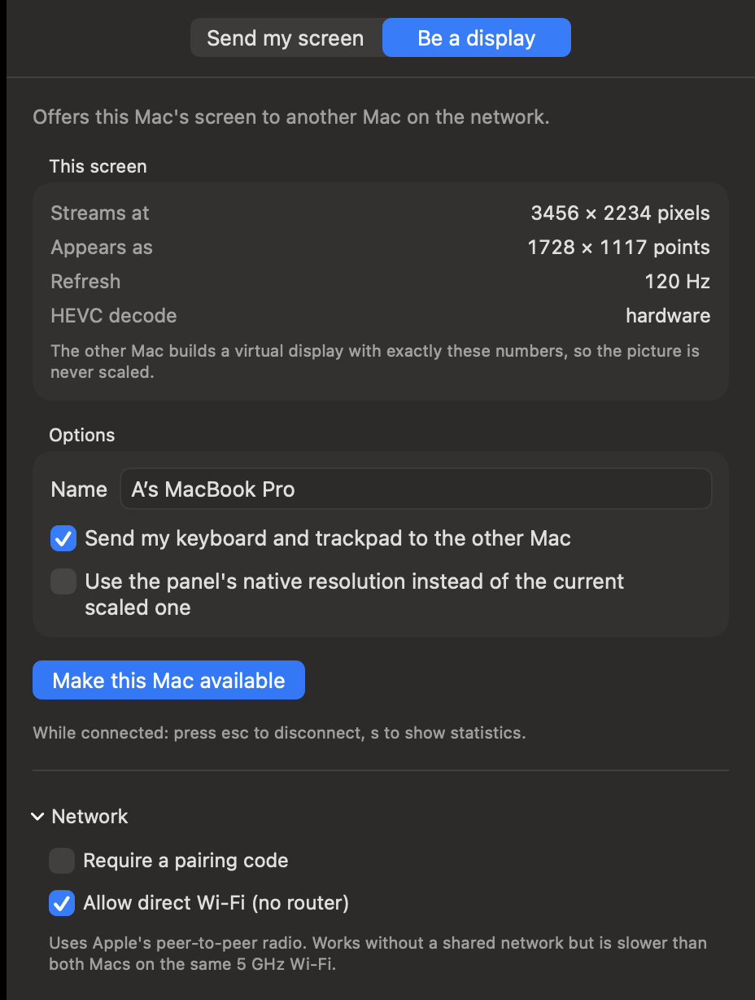
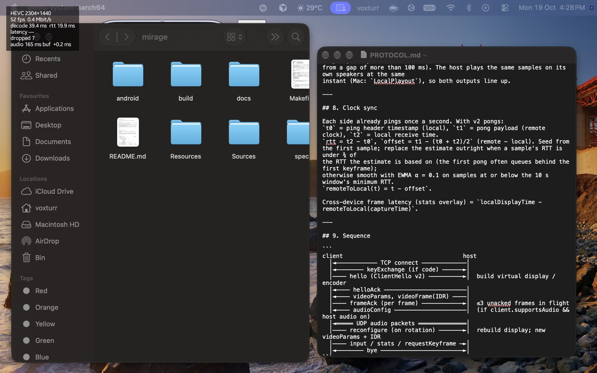
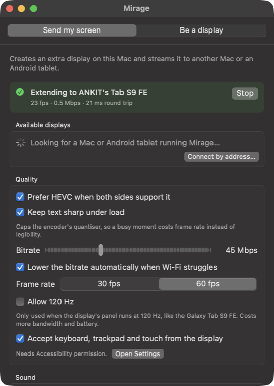
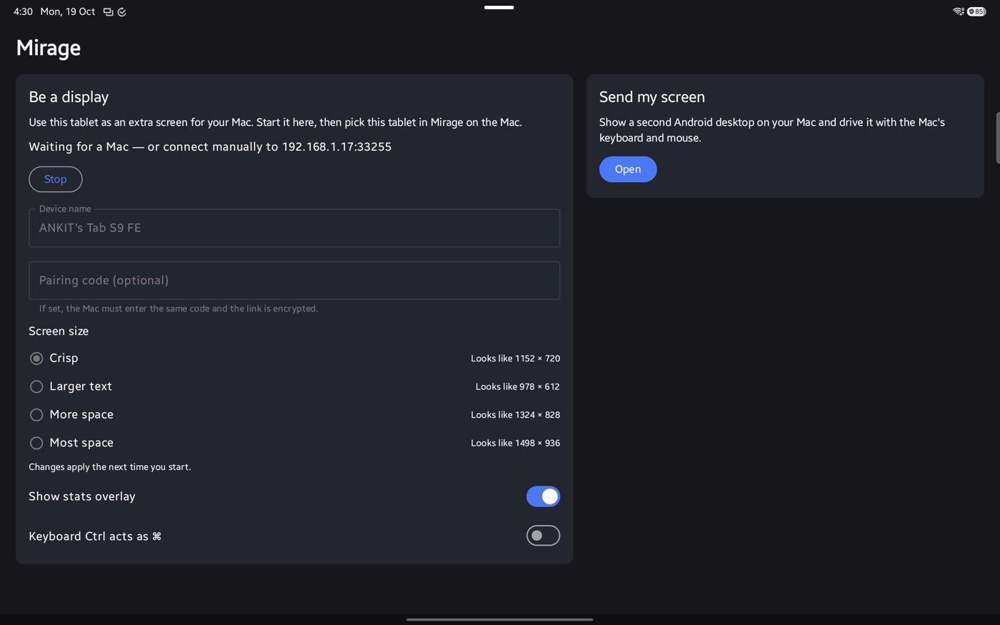
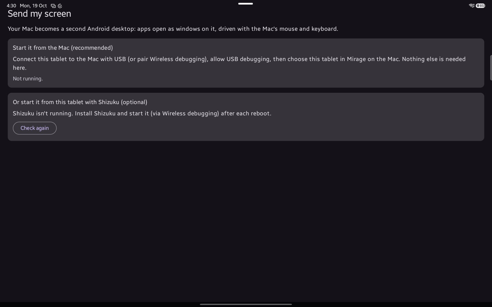

<div align="center">



# Mirage

**Use a second Mac — or an Android tablet — as a real extended display for your main Mac, over Wi-Fi.**

Not a mirror and not a remote-desktop window — an actual entry in System Settings › Displays
that you drag windows onto, with its own space and menu bar. It also works the other way: the
tablet can use your Mac as an extended display for Android.

</div>

---

## What it looks like

| Sending Mac — "Send my screen" | Receiving Mac — "Be a display" |
|---|---|
|  |  |

**New in 2.0 — Android tablets.** A Galaxy Tab S9 FE running as an extended display of a
MacBook Pro: Finder and TextEdit live on the tablet, at a native 2304×1440 with no scaling. The
overlay in the corner is the tablet's live stats (press the back gesture → *Show stats*).



| Mac — sending to the tablet | Tablet — "Be a display" | Tablet — "Send my screen" |
|---|---|---|
|  |  |  |

See [CHANGELOG.md](CHANGELOG.md) for everything that changed.

## How it works

```
   Main Mac (sending)                             Second Mac (receiving)
   ┌────────────────────────────┐                 ┌──────────────────────────┐
   │ MirageDisplayHelper        │                 │                          │
   │   └─ CGVirtualDisplay      │                 │                          │
   │        1440×900 pt         │                 │                          │
   │        2880×1800 px  ──────┼─── TCP ────────►│  AVSampleBufferDisplay   │
   │      ScreenCaptureKit      │   Bonjour       │  Layer, full screen      │
   │      VideoToolbox HEVC     │   TCP_NODELAY   │  hardware HEVC decode    │
   │◄──────────────────────── input ─────────────┤  2880×1800 px, 1:1       │
   └────────────────────────────┘                 └──────────────────────────┘
```

The sending Mac creates a virtual display sized to the receiving Mac's exact panel, captures
it, encodes it in hardware, and streams it. The receiving Mac decodes it into a borderless
full-screen window.

With an Android tablet the same wire protocol ([`spec/PROTOCOL.md`](spec/PROTOCOL.md)) runs in
both directions, and system audio rides alongside on its own UDP flow:

```
   Mac (sending)                                  Android tablet (receiving)
   ┌────────────────────────────┐                 ┌──────────────────────────┐
   │ CGVirtualDisplay, sized by │                 │                          │
   │ the "Screen size" choice   │                 │                          │
   │   ScreenCaptureKit ────────┼─── TCP ────────►│  MediaCodec low-latency  │
   │   VideoToolbox HEVC        │   video+input   │  → SurfaceView, 1:1      │
   │                            │                 │                          │
   │ Core Audio process tap ────┼─── UDP ────────►│  jitter buffer →         │
   │   └─ delayed local playout │   audio, synced │  AudioTrack (scheduled)  │
   │◄──────────────────────── input ─────────────┤  touch / S Pen / keys    │
   └────────────────────────────┘                 └──────────────────────────┘

   Android (sending, started over adb            Mac (receiving — unchanged path)
            or Shizuku, runs as the shell user)
   ┌────────────────────────────┐                 ┌──────────────────────────┐
   │ trusted VirtualDisplay     │                 │                          │
   │   + One UI DeX desktop     │                 │                          │
   │   → MediaCodec HEVC ───────┼─── TCP ────────►│  AVSampleBufferDisplay   │
   │ injectInputEvent ◄─────────┼──── input ──────┤  Layer, full screen      │
   └────────────────────────────┘                 └──────────────────────────┘
```

Built and tested on an **M1 Pro 16" (macOS 26)** sending to a **2017 Intel MacBook Pro**.
Android support is built and tested on a **Samsung Galaxy Tab S9 FE (SM-X510, Android 16 /
One UI 8.5, Exynos 1380, 2304×1440 @ 90 Hz)**, any Android 13+ tablet should work.

---

## Install

Grab `Mirage.dmg` from [Releases](../../releases), or build it yourself (below). The disk
image is universal — the same file installs on Apple Silicon and Intel.

**On both Macs:**

1. Drag `Mirage.app` into `Applications`.
2. Clear the quarantine flag:

   ```bash
   xattr -dr com.apple.quarantine /Applications/Mirage.app
   ```

<details>
<summary><b>Why is step 2 needed?</b></summary>

macOS tags anything arriving from another machine with `com.apple.quarantine`. On first
launch, Gatekeeper checks quarantined apps for a **notarization ticket** — proof the binary
was uploaded to Apple, scanned, and approved. Code signing alone isn't enough; notarization
needs a paid *Developer ID Application* certificate.

Mirage is signed but not notarized, so `xattr -dr` removes the tag and the check never runs.

Prefer not to use Terminal? Same result via the GUI:
- **macOS 13/14:** right-click the app → Open → Open
- **macOS 15+:** double-click, let it get blocked, then System Settings → Privacy & Security
  → **Open Anyway**. Apple removed the right-click bypass in macOS 15.

Be aware this skips Apple's malware scan for this app — reasonable for something you built
from source, not for a random download.
</details>

**On an Android tablet** (Android 13 or newer): the app isn't on the Play Store, so sideload it.

- With a cable and `adb`: enable *Developer options → USB debugging*, plug in, then
  `make android-install` (add `ANDROID_SERIAL=…` when more than one device is attached).
- Without a computer: copy `app-debug.apk` (from `make android`) to the tablet, open it in
  *My Files*, and allow *Install unknown apps* for My Files when asked.

---

## Use

**On the Mac you want to use as the extra screen:** choose **Be a display** → **Make this Mac
available**. No permissions needed on this side.

**On your main Mac:** choose **Send my screen** → grant **Screen Recording** → **quit and
reopen Mirage** (macOS only re-reads that permission at launch) → pick the other Mac →
**Connect**.

A new display appears in System Settings › Displays. Arrange it there so it sits where the
second Mac physically is.

| Key | While connected |
|---|---|
| `esc` | Disconnect and give the second Mac its screen back |
| `s` | Toggle frame rate / bitrate / latency overlay |

### Android tablet as the display

On the tablet: open Mirage → **Be a display**. On the Mac: **Send my screen** → the tablet shows
up with a tablet icon and an **Android** badge → pick a **Screen size** → **Connect**.

The tablet goes full screen and appears in System Settings › Displays like any monitor. Touch
taps and drags, a long press right-clicks, two fingers scroll; the S Pen hovers and clicks, and a
Book Cover or Bluetooth keyboard types into the Mac. Rotate the tablet and the Mac rebuilds the
display in portrait (the screen blinks for about a second).

The back gesture opens a small menu: **Disconnect**, **Show stats** (codec, frame rate,
bitrate, decode time, round trip, audio buffer and sync error).

If the tablet doesn't appear in the list, use **Connect by address…** with the address the
tablet shows under *Be a display* (see [Troubleshooting](#troubleshooting)). From a script:

```bash
open /Applications/Mirage.app --args --connect 192.168.1.17:38407
```

### Mac as a display for Android *(experimental)*

The other direction: the Mac shows a **second Android desktop** — Samsung's DeX desktop, with
its taskbar, app drawer and resizable windows — driven by the Mac's mouse and keyboard.

Android doesn't let an ordinary app put a desktop on another screen or inject input into it.
Code running as the `adb shell` user can, so Mirage's tablet app contains a small server that
is started with shell rights — no root, no extra app:

- **From the Mac over adb (recommended).** *Developer options → USB debugging* on (tap *Build
  number* seven times in *About tablet → Software information* to unlock Developer options), plug
  the tablet in once, allow the Mac. Wireless debugging works too after a one-time pairing.
- **From the tablet with [Shizuku](https://shizuku.rikka.app) (optional).** Install Shizuku,
  start it via *Wireless debugging*, then *Send my screen → Shizuku* in Mirage. Shizuku stops on
  every reboot.

On the Mac choose **Be a display** → **Make this Mac available** (it shows its address), then
start the server. Until the Mac app grows a button for this, it's one command:

```bash
APK=$(adb shell pm path com.voxturr.mirage | sed -n 's/^package://p')
adb shell CLASSPATH=$APK app_process / com.voxturr.mirage.host.privileged.ServerMain \
    --host <Mac IP> --port <Mac port>      # optional: --code 1234 --fps 60 --bitrate 30000
```

It prints `CONNECTING`, `CONNECTED`, then `OK <displayId> <w>x<h> <codec> <fps>` and a `STATS`
line every second; closing the command (Ctrl-C) removes the display and restores every setting.
Over a cable only, add `adb reverse tcp:<port> tcp:<port>` and pass `--host 127.0.0.1`.

What's verified on the Tab S9 FE: a trusted virtual display created this way gets One UI's full
DeX desktop (not a mirror), injected mouse clicks open apps on it, and the HEVC encoder delivers
2304×1440 at 19–22 ms display-to-encoded (p50). The full tablet → Mac session has not yet been
exercised end to end; treat it as experimental.

### Screen size (Android tablets)

A Mac always gets its exact panel. A tablet's panel is denser and smaller than a Mac's, so the
sender offers four sizes per device, remembered by name. **Crisp** is the default and the only
one with no resampling at all — the same 2× Retina mapping a MacBook uses. The others draw a
bigger or smaller desktop and let the Mac's GPU fit it to the panel, exactly like macOS's own
"scaled" resolutions.

Galaxy Tab S9 FE, panel **2304×1440** (landscape):

| Screen size | Looks like | Desktop rendered at | Streamed at |
|---|---|---|---|
| **Crisp** (default) | 1152×720 | 2304×1440 | 2304×1440 |
| Larger text | 980×612 | 1960×1224 | 2304×1440 |
| More space | 1324×828 | 2648×1656 | 2304×1440 |
| Most space | 1498×936 | 2996×1872 | 2304×1440 |

"Looks like" is in points: crisp is half the panel's pixels, the others are ×0.85 / ×1.15 /
×1.3 of that, rounded to even numbers. The picker shows the result for whichever tablet you
pick; the tablet shows the same choices under *Be a display* and the Mac's per-device choice
wins. **Allow 120 Hz** only matters for 120 Hz tablets (a Tab S9 or S10 — the Tab S9 FE tops out
at 90 Hz) and costs bandwidth and battery.

Crisp on a Tab S9 FE is about 124 points per inch — the same density as a 14" MacBook Pro's
default, so menus and text come out the size you're used to.

### Sound

With an Android tablet connected, the Mac's sound can play on **Mac + tablet, in sync**, on the
**tablet only**, or stay on **this Mac only** (*Send my screen → Sound*).

Sync works by giving every sample a play-at time on the Mac's clock, plus a delay — the Mac
holds its own speakers back by the same amount, and the tablet maps that time onto its own
clock (measured with the link's once-a-second ping). Audio travels as raw 48 kHz PCM over its
own UDP flow in Wi-Fi's voice queue, so a big video keyframe can never hold it up.

**The delay adapts to your Wi-Fi.** Every 5 seconds the tablet measures how late packets arrive
(99th percentile) plus its own speaker latency, and if that's more than the current delay it
asks the Mac for more; both speakers move together, so they stay in sync. The **Delay** slider
(default 100 ms) is the floor; **Sync** (−50…+50 ms) nudges the Mac's speakers against the
tablet's if your ears disagree with the clock.

Measured on the Tab S9 FE, on a busy home network:

| | |
|---|---|
| Packet age on arrival (capture → tablet) | 18 ms median, ~100 ms p99 |
| Tablet speaker latency | ~50 ms |
| Delay it settled on | 170–180 ms |
| Tablet playout vs. its target on the shared clock | within ±1 ms |
| Packets lost / reordered | 0 / ~0 |

The ~100 ms tail is the Wi-Fi, not Mirage: Macs pause Wi-Fi briefly and regularly for AirDrop
and Handoff (AWDL), and those pauses are what set the delay. Turning off AirDrop and Handoff
while you work, or a wired link (USB tethering), brings it down. The trade-off is lip-sync:
with a 180 ms delay, sound trails the picture by about 150 ms.

Needs **macOS 14.2 or later** (Core Audio process taps). On older macOS the option is greyed
out and sound stays on the Mac. The first time, macOS asks for **System Audio Recording**.

**Permissions summary**

| Device | Permission | Needed for |
|---|---|---|
| Sending Mac | Screen Recording | Capturing the virtual display. Required. |
| Sending Mac | Accessibility | Only if you enable "Accept keyboard, trackpad and touch from the display" |
| Sending Mac | Local Network | Finding the other device (macOS 15+) |
| Sending Mac | System Audio Recording | Only for sending sound to a tablet (macOS 14.2+) |
| Receiving Mac | *none* | — |
| Tablet, *Be a display* | Nearby devices / notifications | Finding the Mac; the foreground-service notification while connected |
| Tablet, *Send my screen* | USB debugging (adb), or Shizuku | Creating the extra Android desktop and injecting the Mac's input |

---

## Build from source

Needs Xcode 15 or newer on the machine you build on.

```bash
git clone https://github.com/Ankitsaroj94/mirage.git
cd mirage

make                 # build a native .app into build/
make run             # build and launch
make dmg             # universal .dmg for both Macs -> build/Mirage.dmg
make test            # protocol, codec, virtual-display and latency checks (+ Android unit tests)
make icon            # regenerate the app icon
make clean

make android         # Android debug APK -> android/app/build/outputs/apk/debug/app-debug.apk
make android-install # install it on the connected tablet (ANDROID_SERIAL=... to pick one)
make android-test    # Android unit tests, incl. the shared spec/vectors.json
```

The Android app needs JDK 17+ and the Android SDK (Android Studio installs both; point
`ANDROID_HOME` at the SDK or let `android/local.properties` do it).

Build once on the Apple Silicon Mac and use `make dmg` for both machines — the 2017 MacBook
Pro tops out at macOS 13, whose Xcode is too old to compile this.

To copy straight to the other Mac over ssh, skipping the disk image entirely:

```bash
make install-remote HOST=you@othermac
```

By default the build signs with whatever *Apple Development* identity is in your keychain, so
the Screen Recording grant survives rebuilds. Override or force ad-hoc with:

```bash
make dmg SIGN_ID="Developer ID Application: Your Name (TEAMID)"
make dmg SIGN_ID=-
```

---

## Why the text is sharp

Sharpness here is almost entirely about *not resampling*, and the pipeline is built around
that one idea:

1. The receiving Mac reports its exact framebuffer — e.g. `2880×1800 px` shown as `1440×900 pt`.
2. The sending Mac builds a virtual display with precisely those numbers.
3. Capture runs at exactly `2880×1800`, encode at `2880×1800`, and the receiver renders into a
   `2880×1800` framebuffer.

Nothing scales at any stage, so glyph edges land on the pixels they were rendered on.

Two details in the private API do most of the remaining work, and both are easy to get wrong:

- **The point/pixel split is backwards from intuition.** `maxPixelsWide/High` take *pixels*;
  the mode list takes *points*; `hiDPI = 1` makes macOS synthesise the 2× pairing. Passing
  pixel dimensions in the mode — the natural reading — yields a 1×-only display and
  permanently soft text.
- **macOS attaches the display in a 1× mode and stays there.** You have to explicitly switch
  to the synthesised Retina mode with `CGConfigureDisplayWithDisplayMode`. Skipping this is the
  single most common reason home-grown versions of this look blurry.

Beyond geometry: Rec.709/sRGB is tagged identically end to end so no colour transform runs on
playback, and *Keep text sharp under load* caps the encoder's quantiser so a busy moment costs
frame rate rather than legibility.

## Why there's a helper process

**CoreGraphics only lets a process configure one `CGVirtualDisplay`.** The first one created
works; every one after it attaches to the arrangement but reports an empty mode list — no
matter the geometry, the EDID identity, or whether the earlier one was torn down first.
Verified on macOS 26.5 (see `Tests/DisplayHarness`).

Done in-process, this would have worked perfectly on the first connection and silently
produced a non-Retina display on every one after. So each connection spawns
`MirageDisplayHelper`, which owns exactly one display and does nothing else. Quitting it
removes the display cleanly, and the next connection gets a fresh process. Its stdin is a pipe
from the app, so if the app dies the helper sees EOF and takes the display down with it — no
orphaned phantom monitors.

## Latency

Measured end to end (capture stamp → decoded) at 2880×1800, 60 fps, by `Tests/LatencyHarness`:
**~19 ms median, 27 ms p95** — and unchanged at ~20 ms while the main thread is deliberately
jammed for over a second.

Getting there meant fixing three separate things, each of which alone was enough to ruin it:

- **`TCP_NOPUSH` was on.** `NWProtocolTCP.Options.noPush` corks the socket until a full segment
  accumulates. Frames sat in the send buffer; socket-to-arrival time was **1828 ms** on
  loopback. Turning it off took that to **0.9 ms**. This was by far the biggest cause.
- **The video path ran through `@MainActor`.** Every captured and every received frame hopped
  to the main actor and mutated `@Published` statistics, invalidating the whole SwiftUI panel
  up to 180×/second. `Task { @MainActor }` also makes *no ordering guarantee*, so frames could
  reach the decoder out of order. Capture → encode → send and receive → decode now run on their
  own queues; the UI samples a snapshot twice a second.
- **Backpressure only watched the socket.** `pendingBytes` reports what Network.framework
  accepted from us, not what the far end consumed, so a slow receiver was invisible and frames
  queued without limit. The receiver now acknowledges each frame and the sender allows only a
  few unacknowledged frames in flight, which bounds latency no matter which stage is slowest —
  encoder, link, or decoder.

Beyond that:

- `TCP_NODELAY`, plus `serviceClass = .interactiveVideo` so Wi-Fi puts the stream in the video
  access category ahead of bulk traffic.
- VideoToolbox low-latency rate control with B-frames disabled, so no frame waits on a future
  frame.
- Long GOP with keyframes on request rather than on a timer — bitrate goes to pixels that
  changed.
- Frames are presented with `kCMSampleAttachmentKey_DisplayImmediately`, bypassing the display
  layer's presentation queue.
- Backpressure: if the socket hasn't drained, the next frame is dropped rather than encoded,
  keeping the picture current instead of letting it fall behind and stay behind. Sustained
  congestion walks the bitrate down (AIMD); it creeps back up when the link clears.

ScreenCaptureKit only delivers a frame when the screen actually changes, so a static page of
text costs almost nothing — and legitimately reads as `0 fps` in the overlay.

**Android:** the tablet decodes with MediaCodec in low-latency mode straight onto a
`SurfaceView` (a hardware overlay — no GPU composition), and holds a low-latency Wi-Fi lock so
the radio never naps between frames. Two things that were needed on the Tab S9 FE:

- The Exynos HEVC decoder accepts an unbounded `KEY_OPERATING_RATE` at `configure()` and then
  fails `start()` with `NO_MEMORY` — it sizes its buffers from that rate. Mirage asks for a
  bounded rate and falls back to none.
- Samsung doesn't grant an app the low-latency audio fast path, and the default `AudioTrack`
  buffer was 160 ms; Mirage trims it to two mixer bursts (40 ms).

Measured Mac → Tab S9 FE over home Wi-Fi: **13–20 ms network round trip**, 2304×1440 HEVC at
up to 60 fps. A glass-to-glass number needs the clock-synced overlay readout, which is still
being finished — *TBD*.

## Security

Leave the pairing code off on a trusted network and the stream is plain TCP — lowest overhead.
Turn it on and the link does an X25519 key exchange authenticated by an HMAC over the code,
then AES-GCM per message with the header as associated data. Ephemeral keys mean a captured
session stays unreadable even if the code later leaks; a wrong code fails the HMAC without
either side revealing it.

This is deliberately *not* TLS. Network.framework cannot do TLS-PSK — no PSK ciphersuite
appears in `tls_ciphersuite_t`, and TLS 1.3 external PSK is rejected by `NWListener` (all
variants tested). Doing it at the application layer keeps it testable.

---

## Tests

`make test` needs no permissions and takes a few seconds:

| Harness | Checks |
|---|---|
| `Tests/Harness` | framing, packed structs, 400 KB messages, encrypted and wrong-code paths over loopback, and an encrypted link kept alive through heartbeats |
| `Tests/ProtocolV2Harness` | every byte in `spec/vectors.json`, v1 ↔ v2 compatibility, unknown message types, clock sync |
| `Tests/GeometryHarness` | the screen-size planner for tablets and Macs, frame-rate caps |
| `Tests/AudioHarness` | audio ring buffer under contention, packet bytes vs. the spec, resampling, playout scheduling, UDP loopback |
| `Tests/CodecHarness` | 2880×1800 encode → wire bytes → decode, PSNR verified, hardware decode confirmed |
| `Tests/DisplayHarness` | the helper creates a true Retina display at three geometries and removes it on exit |
| `Tests/LatencyHarness` | end-to-end frame latency at 2880×1800, per-stage breakdown, ordering, and a run with the main thread jammed |
| `android/` unit tests | 144 tests: the Kotlin wire format and encryption against the same `spec/vectors.json`, the link over real sockets, decoder framing, touch gestures, audio sync with fake clocks, the Android host's frame pump and input mapping (run when `android/gradlew` exists) |

## Layout

```
Sources/MirageBridge/          ObjC shim over the private CGVirtualDisplay classes
Sources/MirageDisplayHelper/   owns one virtual display, one process
Sources/Mirage/
  Core/      wire protocol, TCP link, Bonjour discovery, encryption
  Host/      virtual display, ScreenCaptureKit, VideoToolbox, input injection,
             screen-size planner; Audio/ = system audio tap, UDP sender, synced playout
  Client/    decode, present, input forwarding
  UI/        control panel, full-screen receiver window
android/                       the Android app (Kotlin): core/ wire + link, receiver/, host/
spec/                          wire protocol v2 and golden test vectors, shared by both apps
Tools/make-icon.swift          the app icon, drawn in code
```

## Troubleshooting

**The other Mac never shows up in the list.** Check that both are on the same network, then
run `dns-sd -B _mirage._tcp local.` on the sending Mac. If nothing appears — and especially if
`dns-sd -B _companion-link._tcp local.` also shows no other Macs — your router is filtering
multicast between clients. Plenty of mesh and guest networks do this. Normal traffic still
flows; only discovery breaks.

Skip discovery and connect by address instead: the receiving side shows its address and port
under **Be a display** once it's available (the tablet shows the same on its screen). On the
sending Mac, **Connect by address…** under *Available displays*, and type them in. A phone or
tablet hotspot, or USB tethering, also works when the router is the problem.

**The tablet never shows up, but Macs do.** Samsung's Wi-Fi power saving can drop multicast;
keep Mirage open in the foreground while you connect, or use **Connect by address…**. Logs:
`adb logcat -s Mirage`. On the network Mirage was tested on, `dns-sd -B _services._dns-sd._udp
local.` listed only the Mac's own services — the router wasn't passing multicast between any
devices — and connecting by address worked first time.

**No sound on the tablet.** Check *Send my screen → Sound* isn't greyed out (needs macOS 14.2+)
and that Mirage is ticked in System Settings › Privacy & Security › *System Audio Recording*.
The tablet logs a line every 5 s (`adb logcat -s Mirage | grep audio`) with packets received,
played and refused, the clock state and the sync error.

**Sound breaks up.** The delay should rise on its own within ~10 s; if it doesn't, raise
**Delay** by hand. Turning off AirDrop and Handoff on the Mac removes most Wi-Fi hiccups.

**Screen Recording keeps failing when started from a terminal.** macOS attributes the
permission to whatever launched Mirage. Start it with `open` (or from Finder), not by running
`Mirage.app/Contents/MacOS/Mirage` directly, or the request goes to your terminal app instead.

**"Send my screen" on the tablet says Shizuku isn't running.** You don't need Shizuku if you
start it from the Mac over adb. If you use Shizuku, it stops on every reboot — open it and start
it again via Wireless debugging.

**Text looks soft.** The app warns when the virtual display didn't take a Retina mode.
Disconnect and reconnect; if it persists, check the receiving Mac isn't running a non-integer
scaled resolution.

**`0 fps` in the overlay.** Expected when the extended display is static — ScreenCaptureKit
only emits a frame when something actually changes.

**Connected but nothing on screen.** Press `s` on the receiving Mac for live stats. Detailed
logs: `log stream --predicate 'subsystem == "com.voxturr.mirage"'`.

## Known limits

- `CGVirtualDisplay` is a private API. Apple could change it in any macOS release; the app
  reports that clearly rather than failing silently, and the shim is isolated in one file.
- Not sandboxable and not App Store distributable, for the same reason.
- The 2017 MacBook Pro tops out at macOS 13, which is why the deployment target is 13.0 and the
  receiver uses `AVSampleBufferDisplayLayer` rather than the newer renderer.
- Sound goes from the Mac to an Android tablet only. A Mac receiving from another Mac stays
  silent, and synced sound needs macOS 14.2+ on the sending Mac.
- Using the Mac as a display for Android is experimental: it needs shell rights (adb or
  Shizuku) and hidden Android APIs (trusted virtual displays, input injection) that a One UI
  update could change. They are isolated in `android/…/host/privileged/`. Sound from the tablet
  to the Mac isn't done yet.
- Synced sound costs lip-sync on a jittery network: the delay rises to cover the worst packets.
- Bonjour discovery depends on the router passing multicast; "Connect by address" always works.
- Rotating the tablet rebuilds the virtual display, so the extended screen blinks for about a
  second.
- *Direct Wi-Fi* (AWDL peer-to-peer) works without a router but is markedly slower than both
  Macs on the same 5 GHz network. Prefer infrastructure Wi-Fi.
